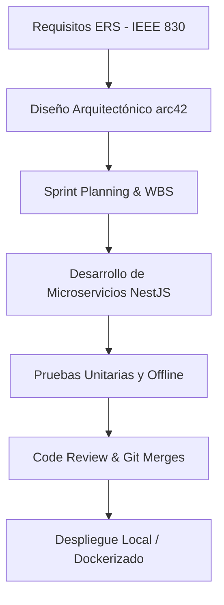
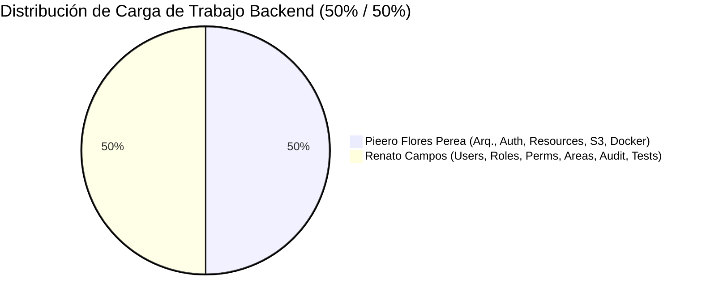

# INFORME DE AVANCE DE PROYECTO: BACKEND DE MICROSERVICIOS (SGAR)

**Proyecto:** Sistema de Gestión Administrativa y Control de Recursos (SGAR)  
**Módulo / Componente:** Backend de Microservicios (`backend-aws-microservices`)  
**Fecha de Emisión:** Septiembre 2026  
**Integrantes:**  
- Pieero Flores Perea (Desarrollo Backend / Infraestructura / Arquitectura)  
- Renato Campos (Desarrollo Backend / Persistencia / Calidad)  
**Asignatura / Contexto:** Proyecto de Título / Capstone — Facultad de Ingeniería  

---

## 1. Ajustes Realizados y por Realizar (Justificación, Dificultades, Facilitadores y Retroalimentación)

En el transcurso del desarrollo del ecosistema de backend, el equipo implementó ajustes técnicos y arquitectónicos esenciales para garantizar la escalabilidad, la seguridad perimetral y el cumplimiento estricto de las especificaciones del sistema.

### 1.1 Ajustes Realizados

1. **Desacoplamiento Absoluto del Frontend:**
   - *Ajuste:* Se eliminó la dependencia del frontend auxiliar previamente ubicado en `backend-aws-microservices/frontend`, migrando y centralizando toda la capa de presentación hacia el proyecto autónomo `frontend-capstone`.
   - *Justificación:* Mantener un frontend monolítico o embebido dentro del repositorio del backend violaba los principios de separación de responsabilidades y despliegue independiente propios de una arquitectura de microservicios.

2. **Unificación de la Capa de Persistencia Compartida con Drizzle ORM:**
   - *Ajuste:* Centralización de las definiciones de esquemas, migraciones y tipos TypeScript en el paquete compartido `database/`, gobernado por Drizzle ORM.
   - *Justificación:* Evita la duplicación y discrepancia de esquemas SQL entre los siete microservicios, permitiendo migraciones atómicas y consistentes (`0000_init` hasta `0004_broker_commands`).

3. **Arquitectura Híbrida de Almacenamiento S3 (Local vs. Cloud):**
   - *Ajuste:* Implementación de un emulador local de S3 (`scripts/local-s3.cjs` y servicio Docker en puerto 9000) compatible con `@aws-sdk/client-s3` y URLs firmadas temporales (`getSignedUrl`).
   - *Justificación:* Permite validar la subida y visualización de recursos multimedia (avatares, documentos, archivos binarios) en entornos locales sin generar costos en AWS ni depender de conectividad a la nube durante pruebas tempranas.

4. **Patrón Broker-RPC y Outbox Transaccional para Eventos de Auditoría:**
   - *Ajuste:* Implementación de comunicación inter-servicio mediante Apache Kafka y RabbitMQ, junto con la tabla `application_outbox`.
   - *Justificación:* Permite procesar comandos RPC con baja latencia y asegura que ningún evento de auditoría (`audit_logs`) se pierda ante caídas de red o fallas transitorias de los brokers.

### 1.2 Dificultades Detectadas y Estrategias de Mitigación

| Dificultad | Impacto en el Proyecto | Estrategia de Mitigación Aplicada |
| :--- | :--- | :--- |
| **Orquestación de Brokers Locales (Kafka/RabbitMQ)** | Alto consumo de memoria y sobrecarga en equipos de desarrollo al levantar múltiples brokers completos. | Creación de scripts automatizados (`npm run brokers:local` y `npm run auth:local`) que aíslan los brokers necesarios y permiten ejecutar los microservicios en modo Node.js nativo. |
| **Validación de Sesiones Inter-Servicio con Baja Latencia** | Cuello de botella si cada microservicio consulta por HTTP a `auth-service` para verificar tokens y sesiones activas. | Integración de RPC sobre RabbitMQ (`BROKER-RPC.md`) para resolución en memoria y cacheo validado de sesiones. |
| **Pruebas Automatizadas sin Dependencias Externas** | Imposibilidad de ejecutar tests unitarios/CI en máquinas sin Docker o bases de datos activas. | Creación de la suite `npm run test:audit:offline` utilizando emuladores SQLite/WASM en memoria para validar la lógica de auditoría y controladores sin infraestructura activa. |

### 1.3 Facilitadores Técnicos y Metodológicos

- **Framework NestJS (v11):** Estructura modular basada en inyección de dependencias, TypeScript nativo y soporte de microservicios para RabbitMQ/Kafka.
- **Drizzle ORM:** Tipado seguro de extremo a extremo, cero abstracción innecesaria sobre SQL y rendimiento superior frente a ORMs pesados.
- **Docker Compose Modular:** Definición declarativa de servicios de soporte (RabbitMQ, Kafka, emulador S3) sin amarrar el ciclo de vida del código de aplicación.

### 1.4 Retroalimentación del Docente y Acciones Tomadas

- **Observación 1:** *Garantizar que el sistema cuente con aislamiento perimetral estricto entre departamentos y no dependa únicamente de filtros en el frontend.*
  - *Acción:* Se implementaron rutas y guards dedicados a nivel de microservicio (`/admin/*`, `/area-admin/areas/:area/*`, y `/area-user/areas/:area/*`), donde el backend valida el rol y que el `areaId` del token coincida exactamente con el parámetro de la petición.
- **Observación 2:** *Asegurar que todas las mutaciones queden registradas en una bitácora inmutable.*
  - *Acción:* Se diseñó el microservicio `audit-service` con persistencia en `audit_logs` y consumo desacoplado de eventos vía Kafka (`application.events.v1`).

---

## 2. Metodología Aplicada y Cumplimiento de Estándares de la Disciplina

El proyecto se rige por un marco de trabajo ágil basado en **Scrum**, adaptado al desarrollo de ingeniería de software con entregas iterativas e incrementales.



### 2.1 Estándares de la Disciplina Aplicados

1. **IEEE 830 (Especificación de Requisitos de Software - ERS):**
   - El backend implementa y da soporte a los 97 requerimientos funcionales documentados en la ERS del proyecto (RF-001 a RF-097).
2. **Modelo de Arquitectura arc42:**
   - La estructura de microservicios, vistas de contexto, componentes técnicos y decisiones de diseño siguen la plantilla internacional arc42 (`docs/notebooklm-sources/02_Documentacion_de_arquitectura_arc42.md`).
3. **Clean Architecture y Principios SOLID:**
   - Separación estricta en cada microservicio entre controladores (capa de transporte/HTTP/RPC), servicios (lógica de negocio), módulos (inyección de dependencias) y repositorios Drizzle (acceso a datos).
4. **Seguridad y Control de Acceso (RBAC):**
   - Principio de mínimo privilegio con roles jerárquicos: `superadministrador`, `administrador` (por área) y `usuario normal`.

### 2.2 Cumplimiento de los Objetivos Propuestos para el Avance

- [x] **Arquitectura base de 7 microservicios** funcional y desacoplada.
- [x] **Capa de base de datos relacional** normalizada con migraciones ejecutadas.
- [x] **Autenticación robusta:** JWT, refresh tokens, expiración y control de sesiones (`user_sessions`).
- [x] **Sistema de subida y almacenamiento de archivos:** Integración completa de `@aws-sdk/client-s3` con URLs firmadas y emulador local.
- [x] **Sistema de Auditoría Unificado:** Registro inmutable de eventos administrativos con contexto de usuario, IP y metadatos.

---

## 3. Evidencias de Avance del Backend

### 3.1 Evidencias de Documentación Técnica

El backend cuenta con documentación técnica exhaustiva en Markdown y JSON que detalla cada subsistema:

- **`README.md`:** Manual operativo general, scripts de arranque, tabla de puertos y topología de servicios.
- **`CRUD.md`:** Especificación formal de los endpoints globales administrativos (`/admin/*`) para usuarios, roles, permisos, áreas, recursos y auditoría.
- **`AREA-ADMIN.md` y `AREA-USER.md`:** Contratos de API para la gestión restringida por área departamental.
- **`BROKER-RPC.md` y `RPC-ROUTES.json`:** Definición de tópicos Kafka, colas RabbitMQ y catálogo de comandos RPC inter-servicio.
- **`AUDIT-EVENTS.md`:** Especificación del esquema de eventos de auditoría (`audit.events.v1`, `application.events.v1`).
- **`AWS-S3-CONFIG.md`:** Guía de configuración para entornos productivos en Amazon S3, políticas IAM de mínimo privilegio y reglas CORS.
- **`SEARCH.md`:** Estandarización de parámetros de paginación, ordenamiento, búsqueda difusa y filtros relacionales.
- **`IMAGES.md`:** Protocolo de subida de archivos multipart, validaciones MIME y generación de URLs firmadas temporales.

### 3.2 Evidencias de Programación y Arquitectura

El ecosistema backend está compuesto por siete microservicios independientes sobre NestJS y Node.js:

```
backend-aws-microservices/
├── auth-service/           # Puerto 3000: JWT, Google OAuth2, sesiones activas
├── roles-service/          # Puerto 3001: Gestión jerárquica de roles
├── permissions-service/    # Puerto 3002: Matriz granular de permisos por módulo
├── resources-service/      # Puerto 3003: Catálogo de activos y subida de archivos S3
├── areas-service/          # Puerto 3004: Unidades organizativas y departamentos
├── users-service/          # Puerto 3005: Usuarios, perfiles, asignación departamental
├── audit-service/          # Puerto 3006: Bitácora inmutable y monitoreo de eventos
├── database/               # Módulo central Drizzle ORM, esquemas y migraciones
├── scripts/                # Automatización: local-s3.cjs, auth-local.cjs, check-backend.cjs
└── docker-compose.yml      # Orquestación de infraestructura compartida
```

#### Tabla de Microservicios y Puertos HTTP

| Microservicio | Puerto | Protocolos | Responsabilidad Principal |
| :--- | :---: | :---: | :--- |
| **auth-service** | 3000 | HTTP / RPC | Login, emisión/renovación JWT, sesiones (`user_sessions`), Google Auth. |
| **roles-service** | 3001 | HTTP / RPC | CRUD de roles, asociación de permisos globales y por área. |
| **permissions-service** | 3002 | HTTP / RPC | Catálogo de capacidades granulares del sistema. |
| **resources-service** | 3003 | HTTP / RPC | Activos digitales/físicos, integración con S3 para imágenes y archivos. |
| **areas-service** | 3004 | HTTP / RPC | Departamentos corporativos y asignación de administradores de área. |
| **users-service** | 3005 | HTTP / RPC | Gestión de identidades, perfiles, avatares S3 y estados de usuario. |
| **audit-service** | 3006 | HTTP / Kafka / RMQ | Recepción de eventos distribuidos y persistencia de auditoría inmutable. |

#### Verificación y Calidad de Código
El backend cuenta con scripts de integración automatizados que validan la salud del ecosistema:
```powershell
npm run backend:build   # Compila database y los 7 servicios en secuencia estricta
npm run backend:test    # Ejecuta pruebas unitarias e integración en memoria
npm run backend:check   # Pipeline integral de compilación y verificación
```

### 3.3 Evidencias de Almacenamiento y Persistencia de Datos

1. **Esquema Relacional PostgreSQL (Drizzle ORM):**
   - Definición de tablas normalizadas en `database/src/schema.ts`:
     - `users`: Identidades, correo electrónico único, rol, área asignada, estado.
     - `roles` y `permissions`: Modelo relacional M:N con `role_permissions`.
     - `areas`: Unidades departamentales con restricción de unicidad de nombre.
     - `resources`: Inventario tipificado mediante Enums (`DOCUMENT`, `FILE`, `LINK`, `IMAGE`, `EQUIPMENT`, etc.) y estados (`ACTIVE`, `INACTIVE`, `ARCHIVED`).
     - `user_sessions`: Trazabilidad de sesiones activas con IP, User-Agent y tokens de refresco.
     - `audit_logs`: Registro histórico inalterable con payload JSONB.
     - `application_outbox`: Cola transaccional para garantizar entrega de eventos.

2. **Almacenamiento de Objetos (Object Storage - AWS S3 / MinIO):**
   - Acceso privado mediante `@aws-sdk/client-s3`.
   - Política de acceso seguro: El bucket permanece con **Block Public Access** activado. La lectura y descarga se autoriza exclusivamente mediante URLs pre-firmadas temporales (`getSignedUrl` con TTL acotado).
   - Estructura de prefijos en bucket: `media/` (avatares e imágenes) y `files/` (documentación y anexos de recursos).

---

## 4. Estructura de Documentación y Trazabilidad en Git

El código y los entregables se encuentran organizados rigurosamente bajo estándares de control de versiones:

- **Estructura y Nomenclatura:** Los directorios siguen la convención kebab-case (`*-service`), manteniendo en la raíz de cada servicio su `src/`, `test/`, `tsconfig.json` y `.env.example`.
- **Higiene del Repositorio:** Reglas estrictas en `.gitignore` que impiden la subida accidental de:
  - Dependencias (`node_modules/`)
  - Artefactos compilados (`dist/`)
  - Archivos con credenciales o secretos (`.env`, `.env.auth-local`)
  - Almacenamiento local temporal (`local-storage/`, `data/`)
- **Trazabilidad de Commits:** Registro incremental de avances en Git, reflejando el progreso modular de cada microservicio y sus pruebas asociadas.

---

## 5. Equidad en el Trabajo y Participación de los Integrantes

El trabajo en el backend se distribuyó de forma equitativa, asignando responsabilidades específicas de arquitectura, infraestructura y lógica de negocio para asegurar un aporte balanceado al 50%:



### Matriz de Contribución Individual

| Integrante | Rol Principal | Componentes y Responsabilidades Desarrolladas | % Participación |
| :--- | :--- | :--- | :---: |
| **Pieero Flores Perea** | Arquitecto de Software & Backend Developer | - Diseño general de la arquitectura de microservicios.<br>- Modelado del esquema relacional central en Drizzle ORM (`database/`).<br>- Configuración de Docker Compose y orquestación de brokers (Kafka y RabbitMQ).<br>- Desarrollo de `auth-service` (JWT, sesiones, integración Google OAuth).<br>- Desarrollo de `resources-service` y capa de integración con AWS S3 / MinIO.<br>- Creación de scripts de emulación local (`local-s3.cjs`). | **50%** |
| **Renato Campos** | Ingeniero de Software & Backend Developer | - Desarrollo de `users-service` y lógica de perfil de usuario.<br>- Implementación de `roles-service` y `permissions-service`.<br>- Desarrollo de `areas-service` y lógica de aislamiento perimetral departamental.<br>- Implementación de `audit-service` y consumo de eventos distribuidos.<br>- Desarrollo de los controladores `/area-admin` y `/area-user`.<br>- Creación de la suite de pruebas unitarias y offline (`npm run test:audit:offline`). | **50%** |

### Conclusión de Equidad
Ambos integrantes han mantenido una participación balanceada y continua, realizando revisiones conjuntas de código (*peer reviews*), validando la interoperabilidad de los siete microservicios y garantizando el cumplimiento de los estándares de calidad exigidos por la asignatura.
