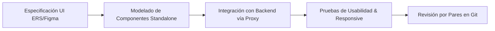
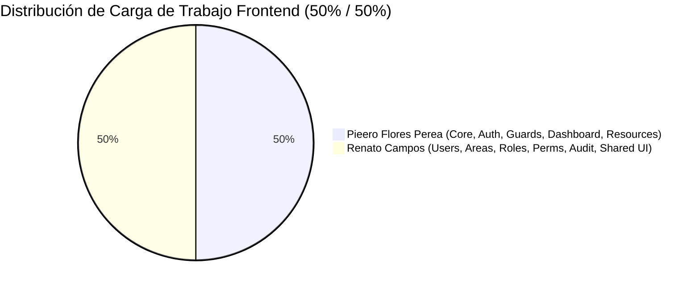

# INFORME DE AVANCE DE PROYECTO: FRONTEND WEB SPA (SGAR)

**Proyecto:** Sistema de Gestión Administrativa y Control de Recursos (SGAR)  
**Módulo / Componente:** Aplicación Frontend Web (`frontend-capstone`)  
**Fecha de Emisión:** Septiembre 2026  
**Integrantes:**  
- Pieero Flores Perea (Desarrollo Frontend / Core & Seguridad / Arquitectura SPA)  
- Renato Campos (Desarrollo Frontend / Features UI / Angular Material & UX)  
**Asignatura / Contexto:** Proyecto de Título / Capstone — Facultad de Ingeniería  

---

## 1. Ajustes Realizados y por Realizar (Justificación, Dificultades, Facilitadores y Retroalimentación)

Durante la fase de construcción de la interfaz de usuario, se ejecutaron decisiones de diseño e ingeniería de software destinadas a garantizar una experiencia de usuario (UX) óptima, un control de acceso perimetral estricto y una comunicación eficiente con la arquitectura de microservicios.

### 1.1 Ajustes Realizados

1. **Independización Total del Proyecto Frontend en `frontend-capstone`:**
   - *Ajuste:* Se desacopló por completo el frontend respecto a la estructura del backend, estableciendo `frontend-capstone` como una SPA (Single Page Application) moderna, autónoma y con su propio pipeline de compilación en Angular 19.
   - *Justificación:* Permite un ciclo de desarrollo ágil, desacopla las dependencias de Node.js de cada capa y facilita la implementación de pruebas y despliegues estáticos independientes (ej. AWS S3 + CloudFront o Nginx).

2. **Migración a Componentes Standalone y Arquitectura Basada en Rutas Perezosas (Lazy Loading):**
   - *Ajuste:* Adopción del estándar Standalone de Angular 19 (`loadComponent` en `app.routes.ts`), prescindiendo de los `NgModules` tradicionales.
   - *Justificación:* Reduce drásticamente el tamaño inicial del bundle JavaScript (*initial load time*), optimiza la carga bajo demanda de los módulos funcionales (`features/`) y mejora la mantenibilidad del código.

3. **Enrutamiento y Proxy Reverso para Microservicios (`proxy.conf.json`):**
   - *Ajuste:* Configuración de un proxy inverso local para canalizar las peticiones de la SPA hacia los diferentes puertos de los microservicios (3000 a 3006).
   - *Justificación:* Evita conflictos de Cross-Origin Resource Sharing (CORS) durante la etapa de desarrollo y simula de forma fidedigna el comportamiento que tendrá el API Gateway en producción.

4. **Aislamiento Visual y Adaptativo por Rol (RBAC):**
   - *Ajuste:* Implementación de Guards funcionales (`authGuard`, `roleGuard`, `publicGuard`) y directivas de control para que la interfaz se adapte según el usuario sea `superadministrador`, `administrador` (por área) o `usuario normal`.
   - *Justificación:* Un administrador departamental solo visualiza los módulos y recursos correspondientes a su unidad de negocio, bloqueando el acceso por URL o manipulación en el cliente.

### 1.2 Dificultades Detectadas y Estrategias de Mitigación

| Dificultad | Impacto en el Proyecto | Estrategia de Mitigación Aplicada |
| :--- | :--- | :--- |
| **Consumo de Múltiples Microservicios en Puertos Diferentes** | Complejidad al invocar endpoints dispersos (Auth: 3000, Users: 3005, Resources: 3003, etc.). | Centralización del consumo mediante `proxy.conf.json` y servicios tipados en `core/services/` que resuelven los paths de forma unificada. |
| **Gestión Reactiva de Estados de Sesión y Expiración de Token** | Pérdida de estado o redirecciones inconsistentes al vencerse el JWT. | Implementación de `auth.interceptor.ts` que captura códigos HTTP 401/403, limpia la sesión en `StorageService` y redirige fluidamente al `/login`. |
| **Carga y Previsualización de Archivos y URLs Firmadas** | Necesidad de gestionar tokens y tiempos de caducidad en imágenes y documentos alojados en S3/MinIO. | Integración en los componentes de recursos de flujos de solicitud de URLs firmadas temporales (`getSignedUrl`), gestionando estados de carga y errores de imagen. |

### 1.3 Facilitadores Técnicos y Metodológicos

- **Angular 19 & TypeScript 5.7:** Tipado estricto en modelos de datos, validaciones en tiempo de compilación y Signals para reactividad declarativa.
- **Angular Material & CDK (v19.2):** Componentes UI accesibles, responsivos y con diseño profesional (tablas con ordenamiento, diálogos modales, datepickers, snackbars).
- **RxJS (v7.8):** Manejo robusto de flujos asíncronos y cancelación de peticiones HTTP en componentes destruidos.

### 1.4 Retroalimentación del Docente y Acciones Tomadas

- **Observación 1:** *El frontend debe validar que las acciones restringidas no sean visibles para roles sin permisos suficientes antes de enviarlas al servidor.*
  - *Acción:* Se implementó la matriz de rutas protegidas mediante `roleGuard` con validación estricta de `data: { roles: [...] }` en `app.routes.ts`, además de ocultar botones de acción en plantillas según los privilegios del token.
- **Observación 2:** *Los formularios de creación y edición deben contar con validaciones inmediatas para evitar errores 400 innecesarios.*
  - *Acción:* Implementación exhaustiva de Formularios Reactivos (`ReactiveFormsModule`) con validadores sincrónicos y mensajes de error contextuales por campo.

---

## 2. Metodología Aplicada y Cumplimiento de Estándares de la Disciplina

El desarrollo del frontend se articula mediante la metodología ágil **Scrum**, sincronizada con el backlog general del proyecto SGAR.



### 2.1 Estándares de la Disciplina Aplicados

1. **Diseño Centrado en el Usuario (UX/UI):**
   - Jerarquía visual coherente, soporte para diseño adaptativo (responsive design para escritorio y dispositivos móviles) y navegación por menús colapsables.
2. **Arquitectura Limpia en Frontend (Clean Frontend Architecture):**
   - Segregación modular en capas: `core/` (servicios singleton, guards, interceptores), `layouts/` (estructuras base), `features/` (páginas de negocio específicas) y `shared/` (componentes y pipes reutilizables).
3. **Estándares Web y Accesibilidad:**
   - Uso de componentes accesibles mediante Angular Material, etiquetas semánticas HTML5 y retroalimentación interactiva en pantalla ante cada operación de red.

### 2.2 Cumplimiento de los Objetivos Propuestos para el Avance

- [x] **Arquitectura base SPA en Angular 19** configurada con enrutamiento reactivo y Standalone components.
- [x] **Módulo de Autenticación (`features/auth`)**: Login interactivo, almacenamiento seguro de token y redirección condicionada por rol.
- [x] **Layout Principal (`layouts/main-layout`)**: Sidebar con menú dinámico según rol, Topbar con perfil de usuario y botón de cierre de sesión.
- [x] **Panel de Control (`features/dashboard`)**: Métricas de activos, usuarios y alertas administrativas.
- [x] **Módulos de Gestión Administrativa (`features/`)**:
  - Gestión de Usuarios (`features/users`): Tablas paginadas, alta y edición.
  - Gestión de Áreas (`features/areas`): Estructura departamental y asignación de jefes.
  - Roles y Permisos (`features/roles`, `features/permissions`): Visualización de catálogo y asignaciones.
  - Catálogo de Recursos (`features/resources`): CRUD de activos, tipificación y manejo de multimedia.
  - Auditoría (`features/audit`): Visor de logs y filtros de búsqueda de eventos.

---

## 3. Evidencias de Avance del Frontend

### 3.1 Evidencias de Documentación Técnica

- **`SGAR_ESPECIFICACIONES_FRONTEND.md`:** Documento formal en `docs/` que recopila la visión general, índice de fuentes de NotebookLM, requerimientos funcionales del frontend (RF-001 al RF-097) y contratos de interfaz.
- **`README.md` del Frontend:** Guía de instalación, variables de entorno, arranque en modo desarrollo (`npm start`) y configuración de proxies locales.

### 3.2 Evidencias de Programación y Arquitectura

La solución frontend presenta la siguiente distribución modular en `frontend-capstone/src/app/`:

```
frontend-capstone/src/app/
├── core/                           # Servicios singleton, seguridad e infraestructura
│   ├── auth/                       # AuthService, AuthInterceptor, Guards (auth, role, public)
│   ├── services/                   # ApiService base, NotificationService, StorageService
│   └── models/                     # Interfaces TypeScript (User, Role, Area, Resource, Audit)
├── layouts/                        # Estructuras maestras de página
│   ├── auth-layout/                # Contenedor limpio para pantalla de inicio de sesión
│   └── main-layout/                # Sidebar, Navbar, perfil de usuario y breadcrumbs
├── features/                       # Módulos de negocio (Carga perezosa / Lazy Loading)
│   ├── auth/login/                 # Formulario de login reactivo con validaciones
│   ├── dashboard/                  # Tablero de control y métricas por rol
│   ├── users/                      # Listado paginado y formularios de usuarios
│   ├── areas/                      # Mantenimiento de departamentos corporativos
│   ├── roles/                      # Definición y administración de roles del sistema
│   ├── permissions/                # Matriz de consulta de permisos granulares
│   ├── resources/                  # Inventario de recursos y carga de archivos/fotos
│   └── audit/                      # Visor interactivo de bitácora de auditoría
├── shared/                         # Componentes, directivas y pipes transversales
└── app.routes.ts                   # Definición centralizada de rutas y guards de protección
```

#### Fragmento de Enrutamiento con Protección RBAC (`app.routes.ts`):
```typescript
// Protección declarativa de rutas mediante guards funcionales
{
  path: 'users',
  title: 'Usuarios',
  canActivate: [roleGuard],
  data: { roles: ['superadministrador'] },
  loadComponent: () => import('./features/users/user-list/user-list.component'),
},
{
  path: 'resources',
  title: 'Recursos',
  canActivate: [authGuard],
  loadComponent: () => import('./features/resources/resource-list/resource-list.component'),
}
```

#### Integración con Backend mediante `proxy.conf.json`:
Permite que el cliente Angular en `http://localhost:4200` consuma los microservicios sin bloqueos de navegador:
```json
{
  "/api/auth": { "target": "http://localhost:3000", "secure": false },
  "/api/roles": { "target": "http://localhost:3001", "secure": false },
  "/api/permissions": { "target": "http://localhost:3002", "secure": false },
  "/api/resources": { "target": "http://localhost:3003", "secure": false },
  "/api/areas": { "target": "http://localhost:3004", "secure": false },
  "/api/users": { "target": "http://localhost:3005", "secure": false },
  "/api/audit": { "target": "http://localhost:3006", "secure": false }
}
```

### 3.3 Evidencias de Manejo y Almacenamiento de Datos en el Cliente

1. **Gestión Segura de Credenciales y Sesión:**
   - La persistencia del token de autenticación se gestiona a través de `StorageService`, abstrayendo el acceso a `localStorage` para garantizar que ante el cierre de sesión o revocación del token se purgue toda traza en memoria.
2. **Inyección de Tokens mediante Interceptor:**
   - `auth.interceptor.ts` clona e inyecta la cabecera `Authorization: Bearer <token>` de forma transparente en cada petición saliente.
3. **Tipado Estricto de Modelos:**
   - Interfaces TypeScript completas para todas las entidades recibidas de la API (`UserResponse`, `ResourceItem`, `AreaDetail`, `AuditLogEntry`), asegurando consistencia de datos y previniendo errores en tiempo de ejecución.

---

## 4. Estructura de Documentación y Trazabilidad en Git

La aplicación frontend cumple con los lineamientos de orden, versionamiento y trazabilidad académica:

- **Estructura Estándar Angular CLI:** Configuración mediante `angular.json`, compilación tipada en `tsconfig.app.json` y control de paquetes con `package.json` y `package-lock.json`.
- **Higiene del Repositorio:** `.gitignore` configurado para omitir cachés de compilación (`.angular/`), directorios de salida (`dist/`), librerías (`node_modules/`) y archivos temporales de editores (`.vscode/`).
- **Control de Cambios:** Commits descriptivos organizados por módulos funcionales y refactorizaciones de componentes.

---

## 5. Equidad en el Trabajo y Participación de los Integrantes

La carga de trabajo en el frontend se distribuyó de manera complementaria y equitativa entre los integrantes, abarcando desde la capa de seguridad y arquitectura hasta la maquetación y experiencia de usuario:



### Matriz de Contribución Individual

| Integrante | Rol Principal | Componentes y Responsabilidades Desarrolladas | % Participación |
| :--- | :--- | :--- | :---: |
| **Pieero Flores Perea** | Frontend Lead & Core Developer | - Configuración inicial de Angular 19 y estructura de directorios.<br>- Implementación de `core/auth/` (`AuthService`, `auth.interceptor.ts`, guards de ruta).<br>- Configuración del proxy inverso para microservicios (`proxy.conf.json`).<br>- Desarrollo de `features/auth` (Login y manejo de sesión).<br>- Desarrollo de `features/dashboard` (Métricas globales y filtros contextuales).<br>- Implementación de `features/resources` (Gestión de recursos y subida de archivos S3). | **50%** |
| **Renato Campos** | Frontend UI & Feature Developer | - Diseño e implementación de `layouts/main-layout` (Sidebar responsivo y Navbar).<br>- Desarrollo de `features/users` (Tabla paginada y modales de creación).<br>- Desarrollo de `features/areas` (Módulo departamental y asignación de jefaturas).<br>- Implementación de `features/roles` y `features/permissions` (Matriz de permisos).<br>- Desarrollo de `features/audit` (Visor de logs inmutables).<br>- Creación de componentes reutilizables en `shared/` con Angular Material. | **50%** |

### Conclusión de Equidad
El desarrollo del frontend refleja una colaboración continua y equitativa al 50%, donde la arquitectura de seguridad y comunicación con el backend (Pieero Flores) se acopló armónicamente con la construcción de las interfaces de usuario y componentes de gestión (Renato Campos), logrando un avance sólido y verificable dentro del repositorio.
