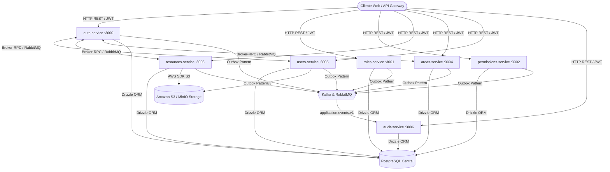
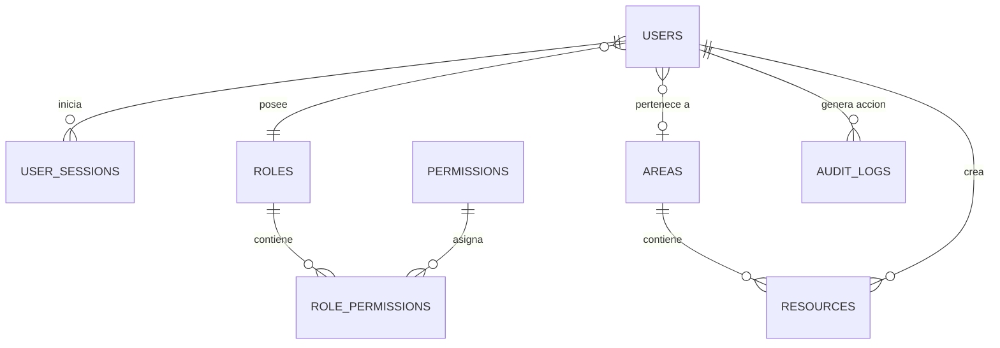
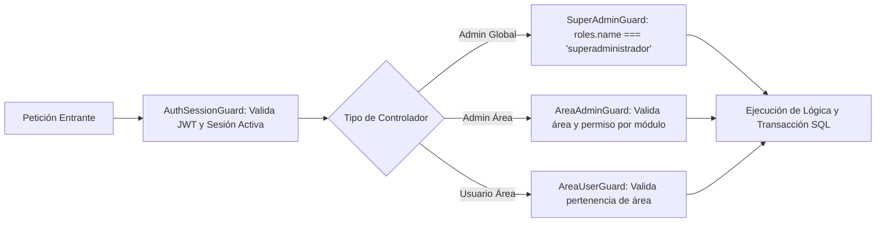

# SGAR - Especificación Técnica y Arquitectura del Backend de Microservicios

> **Documento Oficial de Arquitectura y Especificación Técnica del Backend**  
> **Proyecto:** Sistema de Gestión Administrativa y Control de Recursos (SGAR)  
> **Módulo:** Backend de Microservicios (`backend-aws-microservices`)  
> **Fecha de Emisión:** Septiembre 2026  
> **Versión:** 2.0 (Microservicios desacoplados, Drizzle ORM, Broker-RPC, Kafka/RabbitMQ y S3)  
> **Stack Técnico:** NestJS 11 | Node.js 20.12+ | TypeScript 5.7 | PostgreSQL 16 | Drizzle ORM | Apache Kafka | RabbitMQ | AWS S3 / MinIO  
> **Nota de Alcance:** Este documento abarca exclusivamente el ecosistema backend en `backend-aws-microservices`, excluyendo terminantemente cualquier artefacto o carpeta de frontend embebido (`backend-aws-microservices/frontend`), el cual ha sido migrado al proyecto autónomo `frontend-capstone`.

---

## 1. Visión General y Principios de Diseño

El backend de **SGAR** está diseñado bajo una arquitectura de **microservicios orientados a dominio (DDD)**, estructurada para ofrecer alta disponibilidad, tolerancia a fallos, procesamiento desacoplado y un esquema riguroso de **Control de Acceso Basado en Roles (RBAC)** con **aislamiento perimetral departamental**.



### 1.1 Principios Arquitectónicos Clave
1. **Desacoplamiento Estricto del Frontend:** El backend funciona como una batería de APIs REST y servicios RPC independientes, sin servir assets estáticos de interfaz de usuario.
2. **Identidad Centralizada y Validación en Memoria:** `auth-service` gobierna la autenticación, emisión de tokens JWT, refresh tokens y control de sesiones activas (`user_sessions`). Los restantes servicios validan sesiones inter-servicio mediante Broker-RPC con latencia inferior a 5 ms.
3. **Persistencia Centralizada Tipada:** El módulo compartido `database/` unifica los esquemas relacionales, enums de PostgreSQL y migraciones mediante **Drizzle ORM**, garantizando tipado estricto extremo a extremo.
4. **Trazabilidad Inmutable mediante Outbox Transaccional:** Cada operación que muta datos inserta eventos en la tabla `application_outbox` en la misma transacción SQL. Los eventos se publican asíncronamente a Kafka y RabbitMQ, asegurando consistencia eventual sin pérdida de datos para `audit-service`.
5. **Almacenamiento de Objetos Seguro:** La carga de avatares, fotos de recursos y documentos binarios utiliza `@aws-sdk/client-s3` con buckets privados (Block Public Access) y URLs firmadas temporales (`getSignedUrl` con TTL de 300s).

---

## 2. Catálogo de Microservicios y Topología de Red

El backend se divide en siete microservicios autónomos, cada uno ejecutando su propio proceso NestJS y puerto HTTP:

| Microservicio | Directorio | Puerto | Protocolos | Responsabilidad Funcional |
| :--- | :--- | :---: | :---: | :--- |
| **auth-service** | `auth-service/` | **3000** | HTTP / RPC | Login con credenciales, tokens JWT, refresh tokens, Google OAuth2, sesiones activas e invalidación remota. |
| **roles-service** | `roles-service/` | **3001** | HTTP / RPC | Definición de roles del sistema (`superadministrador`, `administrador`, `usuario normal`) y asignación de permisos. |
| **permissions-service** | `permissions-service/` | **3002** | HTTP / RPC | Catálogo granular de permisos vinculados a módulos de la aplicación. |
| **resources-service** | `resources-service/` | **3003** | HTTP / RPC | Catálogo de activos corporativos (físicos y digitales), tipos, estados y subida de archivos/portadas a S3. |
| **areas-service** | `areas-service/` | **3004** | HTTP / RPC | Mantenimiento de departamentos corporativos (Finanzas, TI, RRHH, etc.) y asignación de administradores de área. |
| **users-service** | `users-service/` | **3005** | HTTP / RPC | Cuentas de usuario, datos de perfil, asignación departamental, avatares multimedia con S3 y estados. |
| **audit-service** | `audit-service/` | **3006** | HTTP / RPC / Consumidor | Bitácora inmutable de eventos (`audit_logs`), consumidor de colas de eventos y visor analítico. |

---

## 3. Modelo de Persistencia y Base de Datos Compartida (`database/`)

El módulo `database/` actúa como biblioteca interna compartida entre todos los microservicios, centralizando la conexión a PostgreSQL y los esquemas declarativos en Drizzle ORM.

### 3.1 Enumeraciones de Base de Datos (PostgreSQL Enums)
- `auth_provider`: `['GOOGLE']`
- `resource_type`: `['DOCUMENT', 'FILE', 'LINK', 'IMAGE', 'VIDEO', 'SOFTWARE', 'LICENSE', 'EQUIPMENT', 'OTHER']`
- `resource_status`: `['ACTIVE', 'INACTIVE', 'ARCHIVED']`

### 3.2 Esquema Relacional de Tablas Principales (`database/src/schema.ts`)



1. **`users`:**
   - `id` (UUID, PK), `email` (VARCHAR 255, UNIQUE), `password_hash` (VARCHAR 255), `name` (VARCHAR 150), `avatar_url` (TEXT), `is_active` (BOOLEAN, default true), `role_id` (FK -> `roles.id`), `area_id` (FK -> `areas.id`), `auth_provider` (`auth_provider`), `created_at`, `updated_at`.
2. **`roles`:**
   - `id` (INT IDENTITY, PK), `name` (VARCHAR 100, UNIQUE: `superadministrador`, `administrador`, `usuario normal`), `description` (TEXT), `is_active` (BOOLEAN), `created_at`, `updated_at`.
3. **`permissions`:**
   - `id` (INT IDENTITY, PK), `key` (VARCHAR 150, UNIQUE), `name` (VARCHAR 150), `module` (VARCHAR 100), `description` (TEXT), `is_active` (BOOLEAN).
4. **`role_permissions`:**
   - `role_id` (FK -> `roles.id`), `permission_id` (FK -> `permissions.id`), PK compuesta (`role_id`, `permission_id`).
5. **`areas`:**
   - `id` (UUID, PK), `name` (VARCHAR 100, UNIQUE), `description` (TEXT), `is_active` (BOOLEAN), `created_at`, `updated_at`.
6. **`resources`:**
   - `id` (UUID, PK), `name` (VARCHAR 200), `description` (TEXT), `type` (`resource_type`), `status` (`resource_status`), `url` (TEXT), `image_url` (TEXT), `area_id` (FK -> `areas.id`), `created_by_id` (FK -> `users.id`), `created_at`, `updated_at`.
7. **`user_sessions`:**
   - `id` (UUID, PK), `user_id` (FK -> `users.id`), `refresh_token_hash` (TEXT), `ip_address` (VARCHAR 45), `user_agent` (TEXT), `is_active` (BOOLEAN), `expires_at` (TIMESTAMP), `created_at`.
8. **`audit_logs`:**
   - `id` (BIGINT IDENTITY, PK), `action` (VARCHAR 100), `entity` (VARCHAR 100), `entity_id` (VARCHAR 100), `user_id` (UUID), `user_email` (VARCHAR 255), `area_id` (UUID), `ip_address` (VARCHAR 45), `details` (JSONB: payload anterior vs nuevo), `created_at`.
9. **`application_outbox`:**
   - `id` (BIGINT IDENTITY, PK), `event_name` (VARCHAR 150), `payload` (JSONB), `status` (VARCHAR 50), `attempts` (INT), `created_at`, `processed_at`.

### 3.3 Migraciones Versionadas de Drizzle
- `0000_initial_schema.sql`: Creación de tablas de usuarios, roles, áreas, recursos y permisos.
- `0001_sessions_and_tokens.sql`: Bitácora de sesiones y refresh tokens.
- `0002_resource_media.sql`: Columnas para imágenes y archivos S3 en recursos y usuarios.
- `0003_application_audit.sql`: Estructura para auditoría general y eventos del sistema.
- `0004_broker_commands.sql`: Soporte para comandos RPC y tablas de desduplicación de eventos (`audit_event_receipts`).

---

## 4. Arquitectura de Mensajería, Eventos y RPC Distribuido

Para desacoplar los microservicios sin introducir bloqueos HTTP entre procesos, el sistema implementa una infraestructura dual con **Apache Kafka** y **RabbitMQ**.

### 4.1 Comandos Request/Reply (Broker-RPC)
Cada microservicio expone un consumidor RPC sobre RabbitMQ (con opción de Kafka) para responder comandos inter-servicio:

| Servicio | Cola RabbitMQ | Tópico Kafka RPC | Función Principal |
| :--- | :--- | :--- | :--- |
| **auth** | `auth_rpc` | `auth.rpc.v1` | Validación de tokens JWT y sesiones `/auth/me` para otros servicios. |
| **roles** | `roles_rpc` | `roles.rpc.v1` | Comprobación de roles y permisos asociados. |
| **permissions** | `permissions_rpc` | `permissions.rpc.v1` | Verificación de módulos y capacidades. |
| **resources** | `resources_rpc` | `resources.rpc.v1` | Consultas de inventario y estado de recursos. |
| **areas** | `areas_rpc` | `areas.rpc.v1` | Validación de pertenencia y estado del departamento. |
| **users** | `users_rpc` | `users.rpc.v1` | Consulta de perfiles, roles asignados y áreas. |
| **audit** | `audit_rpc` | `audit.rpc.v1` | Consultas de bitácora y registro directo. |

#### Contrato de Invocación RPC
```typescript
const response = await brokerGateway.send('auth', {
  version: 1,
  requestId: crypto.randomUUID(),
  expiresAt: new Date(Date.now() + 5000).toISOString(),
  method: 'GET',
  path: '/auth/me',
  accessToken: jwtToken,
});
```

### 4.2 Publicación Asíncrona de Auditoría (Outbox Pattern)
1. Cualquier mutación (INSERT, UPDATE, DELETE) en tablas críticas dispara la inserción de un registro en `application_outbox` dentro de la **misma transacción SQL**.
2. Un worker en segundo plano reclama los registros pendientes mediante `SELECT ... FOR UPDATE SKIP LOCKED`.
3. El worker publica el evento en dos canales independientes:
   - **RabbitMQ:** Cola `audit_queue` (patrón `audit.application.record`), consumida por `audit-service` para persistir en `audit_logs`.
   - **Kafka:** Tópico `application.events.v1` para consumidores de analítica o streaming externo.
4. La tabla `audit_event_receipts` garantiza idempotencia, evitando el registro duplicado de eventos.

---

## 5. Especificación de Endpoints y Contratos de API REST

Todos los endpoints protegidos requieren la cabecera:
`Authorization: Bearer <accessToken>`

### 5.1 Microservicio de Autenticación (`auth-service` - Puerto 3000)

| Método | Endpoint | Acceso | Descripción |
| :--- | :--- | :---: | :--- |
| `POST` | `/auth/login` | Público | Autenticación con `{ email, password }`. Retorna `{ accessToken, refreshToken, user }`. |
| `POST` | `/auth/refresh` | Público | Renovación de tokens mediante `{ refreshToken }`. |
| `POST` | `/auth/logout` | Autenticado | Revoca la sesión actual y el refresh token asociado. |
| `GET` | `/auth/me` | Autenticado | Devuelve el perfil completo del usuario, rol, área asignada y permisos. |
| `POST` | `/auth/google` | Público | Autenticación mediante ID Token de Google `{ idToken }`. |
| `GET` | `/auth/sessions` | Autenticado | Lista las sesiones activas del usuario con IP y User-Agent. |
| `DELETE` | `/auth/sessions/:id` | Autenticado | Cierre remoto de una sesión específica. |

---

### 5.2 API Administrativa Global (`/admin/*`) — Exclusiva `superadministrador`

Disponible en el puerto de cada microservicio correspondiente:

| Microservicio | Endpoint | Métodos | Funcionalidad |
| :--- | :--- | :---: | :--- |
| **users-service (3005)** | `/admin/users` | `GET`, `POST` | Listado paginado y creación de usuarios globales. |
| **users-service (3005)** | `/admin/users/:id` | `GET`, `PATCH`, `DELETE` | Consulta, edición y baja de usuario. |
| **users-service (3005)** | `/admin/users/:id/activate` | `PATCH` | Activa un usuario previamente desactivado. |
| **users-service (3005)** | `/admin/users/:id/deactivate` | `PATCH` | Desactiva un usuario sin eliminar su histórico. |
| **roles-service (3001)** | `/admin/roles` | `GET`, `POST` | CRUD de roles globales. |
| **roles-service (3001)** | `/admin/roles/:id/permissions` | `GET`, `PUT` | Asignación de permisos al rol. |
| **permissions-service (3002)** | `/admin/permissions` | `GET`, `POST` | Catálogo de permisos del sistema. |
| **areas-service (3004)** | `/admin/areas` | `GET`, `POST` | CRUD de áreas departamentales. |
| **resources-service (3003)** | `/admin/resources` | `GET`, `POST` | Catálogo global de recursos de todas las áreas. |
| **resources-service (3003)** | `/admin/resources/:id` | `GET`, `PATCH`, `DELETE` | Modificación y baja de recursos. |
| **audit-service (3006)** | `/admin/audit` | `GET` | Bitácora global con filtros por fecha, usuario, módulo y acción. |
| **audit-service (3006)** | `/admin/audit/:id` | `GET` | Detalle estructurado de un evento de auditoría. |

---

### 5.3 API por Área (`/area-admin/areas/:area/*`) — Rol `administrador`

Controladores dedicados donde `:area` representa el UUID o nombre exacto del área. Requiere que el usuario pertenezca al área y posea un permiso cuyo `module` coincida con el nombre del departamento:

| Microservicio | Endpoint | Métodos | Alcance / Restricción |
| :--- | :--- | :---: | :--- |
| **resources-service (3003)** | `/area-admin/areas/:area/resources` | `POST`, `GET` | Crea o lista recursos pertenecientes exclusivamente al área. |
| **resources-service (3003)** | `/area-admin/areas/:area/resources/:id` | `GET`, `PATCH`, `DELETE` | Operaciones sobre recursos del área. |
| **users-service (3005)** | `/area-admin/areas/:area/users` | `POST`, `GET` | Lista y crea usuarios no administrativos para su departamento. |
| **users-service (3005)** | `/area-admin/areas/:area/users/:id` | `GET`, `PATCH` | Modificación de usuarios de su área. |
| **users-service (3005)** | `/area-admin/areas/:area/users/:id/activate` | `PATCH` | Activa un usuario perteneciente a su área. |
| **users-service (3005)** | `/area-admin/areas/:area/users/:id/deactivate` | `PATCH` | Desactiva un usuario de su área. |
| **audit-service (3006)** | `/area-admin/areas/:area/audit` | `GET` | Consulta eventos de auditoría originados en su departamento. |

---

### 5.4 API de Usuario de Área (`/area-user/areas/:area/*`) — Rol `usuario normal`

Controlador en `resources-service` (puerto 3003) para operadores departamentales:

| Método | Endpoint | Descripción |
| :--- | :--- | :--- |
| `POST` | `/area-user/areas/:area/resources` | Registro de un nuevo recurso en el área asignada del usuario. |
| `GET` | `/area-user/areas/:area/resources` | Listado de recursos del área (admite paginación y búsqueda). |
| `GET` | `/area-user/areas/:area/resources/:id` | Consulta detallada de un recurso del área. |
| `PATCH` | `/area-user/areas/:area/resources/:id` | Actualización de datos de un recurso propio del área. |
| `DELETE` | `/area-user/areas/:area/resources/:id` | Eliminación de un recurso del área. |

---

## 6. Almacenamiento de Objetos y Gestión Multimedia (AWS S3 / MinIO)

El almacenamiento binario se delega al SDK oficial `@aws-sdk/client-s3`. Todos los archivos y fotos se transfieren mediante peticiones `multipart/form-data` con el campo `file`.

### 6.1 Rutas de Carga de Avatares y Archivos

| Microservicio | Endpoint | Tamaño Máx. | Tipos Permitidos | Acceso |
| :--- | :--- | :---: | :---: | :--- |
| **users-service (3005)** | `POST/PUT /users/me/avatar` | **5 MiB** | JPEG, PNG, WEBP | Cualquier usuario autenticado (avatar propio). |
| **users-service (3005)** | `GET /users/me/avatar` | — | — | Retorna metadatos y `downloadUrl` firmada (TTL 300s). |
| **users-service (3005)** | `DELETE /users/me/avatar` | — | — | Elimina el avatar del usuario. |
| **resources-service (3003)** | `POST/PUT /resources/:id/image` | **5 MiB** | JPEG, PNG, WEBP | Portada del recurso (mismo departamento o superadmin). |
| **resources-service (3003)** | `POST/PUT /resources/:id/file` | **25 MiB** | PDF, DOCX, ZIP, binarios | Archivo principal adjunto al recurso. |
| **resources-service (3003)** | `GET /resources/:id/file` | — | — | Retorna URL firmada temporal de descarga directa. |
| **resources-service (3003)** | `PUT /resources/:id/url` | — | — | Asocia un enlace web externo `{ "url": "https://..." }`. |

### 6.2 Políticas de Seguridad S3
- **Block Public Access:** El bucket permanece 100% privado en AWS S3.
- **Acceso Temporal:** Ninguna URL directa al bucket es expuesta. Las descargas se autorizan mediante URLs pre-firmadas generadas por el backend con un tiempo de vida (TTL) de 300 segundos.
- **Entorno Local:** Durante desarrollo, el script `scripts/local-s3.cjs` o el contenedor `s3` en el puerto 9000 emulan la API de S3 compatible con el SDK.

---

## 7. Seguridad, Guards y Control de Acceso

La seguridad se ejecuta en capas a nivel de cada microservicio:



1. **`AuthSessionGuard`:** Extrae el token `Bearer`, verifica la firma criptográfica y valida el estado de la sesión en `user_sessions` mediante llamada RPC a `auth-service`.
2. **`SuperAdminGuard`:** Requiere coincidencia exacta con el rol `superadministrador`.
3. **`AreaAdminGuard`:** Comprueba en base de datos que el usuario pertenezca al área indicada en la URL y que su rol posea un permiso cuyo campo `module` sea idéntico al nombre del departamento.
4. **`AreaUserGuard`:** Comprueba que `users.area_id` corresponda estrictamente al recurso operado.

---

## 8. Infraestructura, Docker y Scripts de Operación

El repositorio backend cuenta con un conjunto de herramientas de automatización en `scripts/` para simplificar la administración local:

### 8.1 Scripts en `package.json`

```powershell
# Compilación estricta de database y los 7 microservicios
npm run backend:build

# Ejecución de pruebas unitarias y suite de auditoría offline (PostgreSQL WASM en memoria)
npm run backend:test

# Pipeline completo de verificación (build + tests)
npm run backend:check

# Configuración automática de variables .env locales para todos los servicios
npm run env:configure

# Levantar infraestructura compartida de brokers (Kafka + RabbitMQ) en Docker
npm run brokers:local

# Levantar autenticación y auditoría con infraestructura compartida
npm run auth:local

# Detener contenedores locales
npm run auth:local:stop

# Inspeccionar logs de contenedores
npm run auth:local:logs
```

### 8.2 Composición de `docker-compose.yml`
El archivo de orquestación local incluye:
- `kafka`: Broker Apache Kafka con listeners configurados para Docker y host.
- `rabbitmq`: Servidor RabbitMQ con plugin de administración (puertos 5672 y 15672).
- `s3`: Emulador local de almacenamiento compatible con Amazon S3 (puerto 9000).
- `auth` y `audit`: Contenedores opcionales para ejecutar servicios bajo el perfil `auth`.
