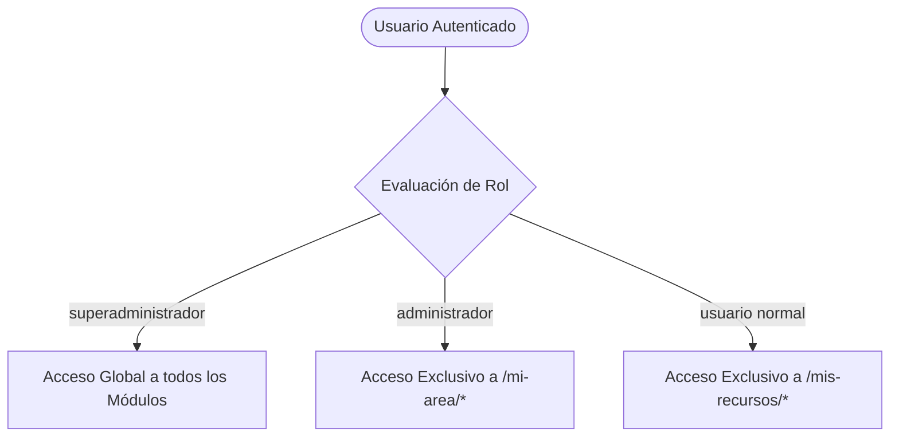

# SGAR - Especificación Técnica y Estado de Implementación del Frontend (Angular 19)

> **Documento Oficial de Arquitectura e Implementación del Frontend**  
> **Proyecto:** Sistema de Gestión Administrativa y Control de Recursos (SGAR)  
> **Módulo:** Aplicación Web SPA (`frontend-capstone`)  
> **Fecha de Actualización:** Septiembre 2026  
> **Versión:** 2.0 (Actualizado según código fuente activo y arquitectura Standalone)  
> **Stack Técnico:** Angular 19.2.0 | Angular Material 19.2.19 | TypeScript 5.7 | RxJS 7.8 | SCSS  

---

## 1. Visión General del Frontend

El **Frontend de SGAR** es una Single Page Application (SPA) modular, reactiva y desacoplada del backend, alojada en [`frontend-capstone/`](file:///c:/Users/krizt/OneDrive/Documentos/Github/Capston/frontend-capstone). Proporciona la interfaz gráfica corporativa para la gobernanza de activos, gestión departamental, control de identidades y visualización de auditoría inmutable bajo un esquema de **Control de Acceso Basado en Roles (RBAC)** y **aislamiento perimetral departamental**.

### 1.1 Objetivos Técnicos Implementados
1. **Arquitectura 100% Standalone:** Eliminación total de `NgModule`, utilizando componentes, pipes y directivas independientes con resolución dinámica mediante rutas perezosas (`loadComponent`).
2. **Seguridad y Aislamiento Perimetral en Cliente:** Control estricto de acceso mediante guards funcionales (`authGuard`, `roleGuard`, `publicGuard`), impidiendo que usuarios no autorizados o administradores de área accedan a vistas o modifiquen recursos fuera de su alcance.
3. **Consumo Desacoplado Multi-Microservicio:** Integración transparente mediante `proxy.conf.json` hacia los 7 microservicios NestJS locales (puertos 3000 a 3006), eliminando bloqueos de CORS en desarrollo.
4. **Carga y Visualización de Archivos con S3:** Soporte integrado para arrastrar y soltar (*drag & drop*) archivos y portadas de recursos, interactuando con endpoints que gestionan URLs firmadas de Amazon S3 y MinIO.

---

## 2. Índice de Fuentes y Trazabilidad

La implementación del frontend responde directamente a los requisitos especificados en las fuentes oficiales del proyecto respaldadas en [`docs/notebooklm-sources/`](file:///c:/Users/krizt/OneDrive/Documentos/Github/Capston/docs/notebooklm-sources):

| # | Fuente Local | Documento Base | Alcance en el Frontend Implementado |
|---|---|---|---|
| **01** | [`01_Acta_Constitucion_Proyecto.docx.md`](file:///c:/Users/krizt/OneDrive/Documentos/Github/Capston/docs/notebooklm-sources/01_Acta_Constitucion_Proyecto.docx.md) | Acta de Constitución | Hitos de entrega, 13 módulos del sistema y segregación de roles. |
| **02** | [`02_Documentacion_de_arquitectura_arc42.md`](file:///c:/Users/krizt/OneDrive/Documentos/Github/Capston/docs/notebooklm-sources/02_Documentacion_de_arquitectura_arc42.md) | Arquitectura arc42 | Patrón SPA, autenticación JWT, guards, interceptores y vistas modulares. |
| **03** | [`03_ERS-Especificacion_de_Requisitos_del_software-APT.docx.md`](file:///c:/Users/krizt/OneDrive/Documentos/Github/Capston/docs/notebooklm-sources/03_ERS-Especificacion_de_Requisitos_del_software-APT.docx.md) | ERS (IEEE 830) | Cumplimiento de los 97 requerimientos funcionales (RF-001 a RF-097). |
| **04** | [`06_PMOInformatica_Plantilla_de_Casos_de_Uso-APT.md`](file:///c:/Users/krizt/OneDrive/Documentos/Github/Capston/docs/notebooklm-sources/06_PMOInformatica_Plantilla_de_Casos_de_Uso-APT.md) | Casos de Uso | Flujos paso a paso para login, asignación de recursos y bitácora de auditoría. |
| **05** | [`08_base_de_datos.jpeg.md`](file:///c:/Users/krizt/OneDrive/Documentos/Github/Capston/docs/notebooklm-sources/08_base_de_datos.jpeg.md) | Diagrama Relacional | Modelado de interfaces TypeScript en `core/models/` idénticas a los esquemas de base de datos. |

---

## 3. Arquitectura del Código Fuente

El código se organiza bajo el patrón de **Arquitectura Limpia en Frontend**, separando infraestructura, presentación estructural, módulos de negocio y componentes reutilizables:

```
frontend-capstone/src/
├── app/
│   ├── core/                           # Servicios singleton, seguridad, modelos
│   │   ├── auth/                       # AuthService, AuthInterceptor, Guards
│   │   │   ├── auth.guard.ts           # Protección de rutas autenticadas
│   │   │   ├── role.guard.ts           # Protección por rol (superadmin, admin, usuario)
│   │   │   ├── auth.interceptor.ts     # Inyección automática de Bearer JWT
│   │   │   └── auth.service.ts         # Señales de estado, login, logout, roles
│   │   ├── models/                     # Interfaces TypeScript tipadas
│   │   │   ├── user.model.ts           # Modelos de usuario y perfil
│   │   │   ├── area.model.ts           # Modelos de departamentos/áreas
│   │   │   ├── role.model.ts           # Modelos de roles del sistema
│   │   │   ├── permission.model.ts     # Modelos de permisos granulares
│   │   │   ├── resource.model.ts       # Modelos y Enums de recursos (ACTIVE, FILE, etc.)
│   │   │   └── audit-log.model.ts      # Modelos de eventos de auditoría y payload
│   │   └── services/                   # Servicios HTTP hacia microservicios
│   │       ├── users.service.ts        # Consumo de /api/users
│   │       ├── areas.service.ts        # Consumo de /api/areas
│   │       ├── roles.service.ts        # Consumo de /api/roles
│   │       ├── permissions.service.ts  # Consumo de /api/permissions
│   │       ├── resources.service.ts    # Consumo de /api/resources (subida, CRUD)
│   │       └── audit.service.ts        # Consumo de /api/audit (logs, filtros)
│   ├── layouts/                        # Plantillas estructurales de diseño
│   │   ├── auth-layout/                # Contenedor para autenticación (limpio, centrado)
│   │   └── main-layout/                # Sidebar colapsable, Topbar, navegación por roles
│   ├── features/                       # Módulos de funcionalidad de negocio (Lazy Loaded)
│   │   ├── auth/login/                 # Formulario reactivo de login
│   │   ├── dashboard/                  # Panel principal adaptativo con métricas
│   │   ├── users/                      # user-list, user-form
│   │   ├── areas/                      # area-list, area-form
│   │   ├── roles/                      # role-list, role-form
│   │   ├── permissions/                # permission-list, permission-form
│   │   ├── resources/                  # resource-list, resource-form, resource-upload
│   │   └── audit/                      # audit-list, audit-detail
│   ├── shared/                         # Componentes comunes transversales
│   │   └── components/
│   │       ├── page-header/            # Encabezado estándar con acciones y migas
│   │       ├── status-badge/           # Insignias visuales de estado (ACTIVE/INACTIVE/ARCHIVED)
│   │       └── confirm-dialog/         # Cuadro modal de confirmación con Angular Material
│   ├── app.component.ts                # Componente raíz con <router-outlet>
│   ├── app.config.ts                   # Configuración de proveedores (HTTP, Router, Animaciones)
│   └── app.routes.ts                   # Árbol de enrutamiento con protección RBAC
├── environments/
│   └── environment.ts                  # Variables de entorno y mapeo a /api/*
├── proxy.conf.json                     # Redirección proxy inversa hacia puertos 3000-3006
└── styles.scss                         # Sistema de diseño con Angular Material y utilidades
```

---

## 4. Matriz de Roles y Enrutamiento Protegido

El sistema implementa 3 roles operativos con vistas y alcances estrictamente delimitados en [`src/app/app.routes.ts`](file:///c:/Users/krizt/OneDrive/Documentos/Github/Capston/frontend-capstone/src/app/app.routes.ts):



### 4.1 Árbol de Rutas y Permisos

| Rol Autorizado | Ruta | Componente | Alcance / Restricción |
| :--- | :--- | :--- | :--- |
| **Público** | `/login` | `LoginComponent` | `canActivate: [publicGuard]` (redirecciona a `/dashboard` si ya está autenticado). |
| **Todos** | `/dashboard` | `DashboardComponent` | Panel de control contextual según el rol autenticado. |
| **`superadministrador`** | `/users` | `UserListComponent` | Gestión completa de usuarios de toda la organización. |
| **`superadministrador`** | `/users/new`, `/users/:id` | `UserFormComponent` | Creación y edición de usuarios, asignación de rol y área. |
| **`superadministrador`** | `/areas`, `/areas/new`, `/areas/:id` | `AreaListComponent` / `AreaFormComponent` | Catálogo departamental y asignación de jefaturas. |
| **`superadministrador`** | `/roles`, `/roles/new`, `/roles/:id` | `RoleListComponent` / `RoleFormComponent` | Administración de roles globales. |
| **`superadministrador`** | `/permissions`, `/permissions/new`, `/permissions/:id` | `PermissionListComponent` / `PermissionFormComponent` | Matriz de permisos del sistema. |
| **`superadministrador`** | `/resources`, `/resources/new`, `/resources/:id/edit` | `ResourceListComponent` / `ResourceFormComponent` | Catálogo global de recursos corporativos. |
| **`superadministrador`** | `/resources/:id/upload` | `ResourceUploadComponent` | Subida de archivos binarios e imágenes de portada a S3. |
| **`superadministrador`** | `/audit`, `/audit/:id` | `AuditListComponent` / `AuditDetailComponent` | Bitácora global de auditoría con visor de JSON diff. |
| **`administrador`** *(Área)* | `/mi-area/resources` | `ResourceListComponent` | `areaScoped: true` — Solo recursos del departamento asignado. |
| **`administrador`** *(Área)* | `/mi-area/resources/new`, `.../:id/edit` | `ResourceFormComponent` | Alta y modificación restringida al área del usuario. |
| **`administrador`** *(Área)* | `/mi-area/resources/:id/upload` | `ResourceUploadComponent` | Carga de archivos para recursos de su propia área. |
| **`administrador`** *(Área)* | `/mi-area/users`, `.../new`, `.../:id/edit` | `UserListComponent` / `UserFormComponent` | Gestión de usuarios exclusivamente de su departamento. |
| **`administrador`** *(Área)* | `/mi-area/audit`, `.../:id` | `AuditListComponent` / `AuditDetailComponent` | Eventos de auditoría originados en su departamento. |
| **`usuario normal`** *(Operador)* | `/mis-recursos` | `ResourceListComponent` | `userScoped: true` — Visualización de recursos asignados a su área. |
| **`usuario normal`** *(Operador)* | `/mis-recursos/new`, `.../:id/edit` | `ResourceFormComponent` | Registro de recursos permitidos para su rol. |
| **`usuario normal`** *(Operador)* | `/mis-recursos/:id/upload` | `ResourceUploadComponent` | Carga de documentación o portada para recursos propios. |

---

## 5. Detalle de Módulos Funcionales Implementados

### 5.1 Autenticación y Manejo de Sesión (`features/auth`)
- **Flujo:** Formulario reactivo con control de credenciales (`email`, `password`), validaciones sincrónicas y soporte para Google OAuth.
- **Manejo de Estado:** `AuthService` utiliza **Angular Signals** (`_authState`, `user`, `profile`, `token`) para notificar instantáneamente a los componentes sobre cambios de autenticación.
- **Intercepción HTTP:** `auth.interceptor.ts` inyecta automáticamente la cabecera `Authorization: Bearer <token>` y captura respuestas `401 Unauthorized` para cerrar sesión automáticamente y redirigir al login.

### 5.2 Layout Principal y Navegación Adaptativa (`layouts/main-layout`)
- **Barra Lateral Reactiva:** Muestra secciones agrupadas (`General`, `Administración Global`, `Mi Área`, `Mi Espacio`). Las secciones se filtran dinámicamente mediante `computed()` evaluando el rol activo (`authService.hasAnyRole()`).
- **Insignias de Rol:** Etiquetas visuales destacadas para el usuario (`role-tag--superadmin`, `role-tag--areaadmin`, `role-tag--operator`).
- **Encabezado Superior (Topbar):** Muestra el nombre del área activa, nombre del usuario, avatar y menú desplegable para cierre de sesión.

### 5.3 Gestión de Recursos y Subida Multimedia (`features/resources`)
- **Catálogo de Activos:** Tipos soportados mediante Enums tipados:
  - `DOCUMENT`, `FILE`, `LINK`, `IMAGE`, `VIDEO`, `SOFTWARE`, `LICENSE`, `EQUIPMENT`, `OTHER`.
  - Estados: `ACTIVE`, `INACTIVE`, `ARCHIVED`.
- **Carga de Archivos (`ResourceUploadComponent`):**
  - Zona interactiva de arrastrar y soltar (*Drag & Drop*) y selector nativo de archivos.
  - Carga separada para el archivo principal y la imagen de portada.
  - Previsualización inmediata en miniatura y visor modal integrado para imágenes en alta resolución.
  - Enlaces de descarga directa mediante URLs temporales pre-firmadas generadas por el backend con AWS S3 / MinIO.

### 5.4 Gestión de Usuarios y Áreas (`features/users`, `features/areas`)
- **Usuarios:** Listado paginado con filtro de búsqueda por texto y estado. Creación y edición con asignación de roles y departamentos.
- **Áreas:** Administración de departamentos corporativos (TI, Finanzas, Recursos Humanos, Operaciones) con asignación de administradores responsables (`AREA_ADMIN`).

### 5.5 Roles y Permisos (`features/roles`, `features/permissions`)
- Consulta del catálogo de permisos granulares por módulo.
- Creación y mantenimiento de roles del sistema, garantizando la integridad referencial con el backend.

### 5.6 Auditoría y Bitácora Inmutable (`features/audit`)
- **Listado:** Filtros por módulo, tipo de acción (`CREATE`, `UPDATE`, `DELETE`, `LOGIN`), usuario responsable y rango temporal.
- **Detalle de Auditoría (`AuditDetailComponent`):** Muestra el registro completo del evento, incluyendo metadatos de red (dirección IP, navegador/User-Agent) y el visor estructurado de datos (payload anterior vs. nuevo en formato JSON).

---

## 6. Configuración de Red y Proxy Inverso Multi-Microservicio

Para permitir que el servidor de desarrollo de Angular (`http://localhost:4200`) interactúe de forma transparente con los siete microservicios sin requerir configuración especial de CORS, se utiliza [`proxy.conf.json`](file:///c:/Users/krizt/OneDrive/Documentos/Github/Capston/frontend-capstone/proxy.conf.json):

```json
{
  "/api/auth":        { "target": "http://127.0.0.1:3000", "secure": false, "changeOrigin": true, "pathRewrite": { "^/api/auth": "" } },
  "/api/roles":       { "target": "http://127.0.0.1:3001", "secure": false, "changeOrigin": true, "pathRewrite": { "^/api/roles": "" } },
  "/api/permissions": { "target": "http://127.0.0.1:3002", "secure": false, "changeOrigin": true, "pathRewrite": { "^/api/permissions": "" } },
  "/api/resources":   { "target": "http://127.0.0.1:3003", "secure": false, "changeOrigin": true, "pathRewrite": { "^/api/resources": "" } },
  "/api/areas":       { "target": "http://127.0.0.1:3004", "secure": false, "changeOrigin": true, "pathRewrite": { "^/api/areas": "" } },
  "/api/users":       { "target": "http://127.0.0.1:3005", "secure": false, "changeOrigin": true, "pathRewrite": { "^/api/users": "" } },
  "/api/audit":       { "target": "http://127.0.0.1:3006", "secure": false, "changeOrigin": true, "pathRewrite": { "^/api/audit": "" } }
}
```

Las variables de entorno en [`src/environments/environment.ts`](file:///c:/Users/krizt/OneDrive/Documentos/Github/Capston/frontend-capstone/src/environments/environment.ts) consumen directamente estas rutas relativas `/api/*`.

---

## 7. Comandos de Ejecución y Pruebas

Desde la raíz del proyecto [`frontend-capstone/`](file:///c:/Users/krizt/OneDrive/Documentos/Github/Capston/frontend-capstone):

```powershell
# Iniciar servidor de desarrollo con el proxy de microservicios habilitado
npm start

# Compilar bundle de producción optimizado
npm run build

# Compilar en modo desarrollo con observador de cambios
npm run watch

# Ejecutar suite de pruebas unitarias con Karma y Jasmine
npm test
```
